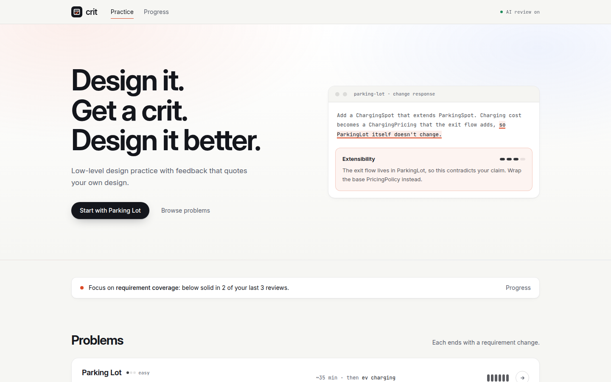
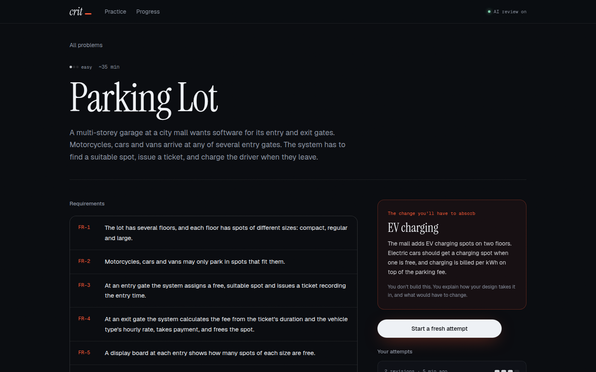
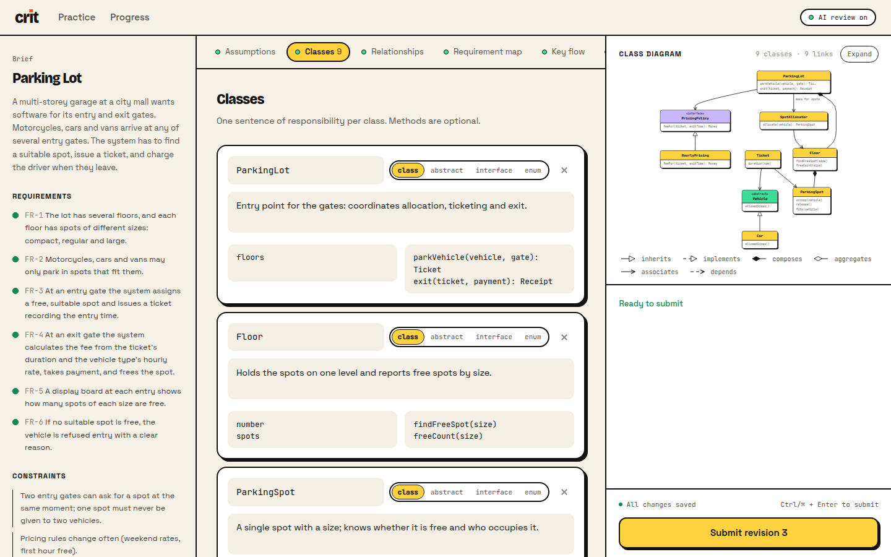
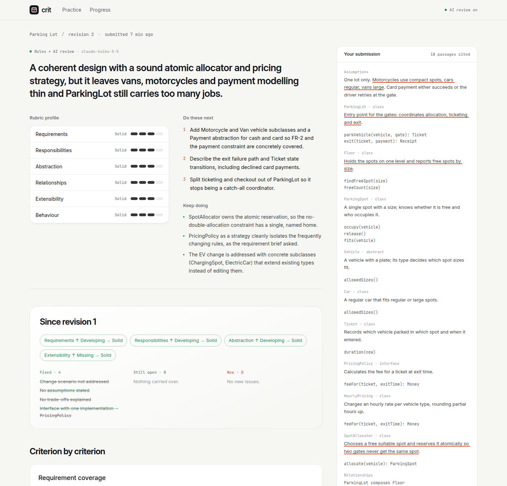
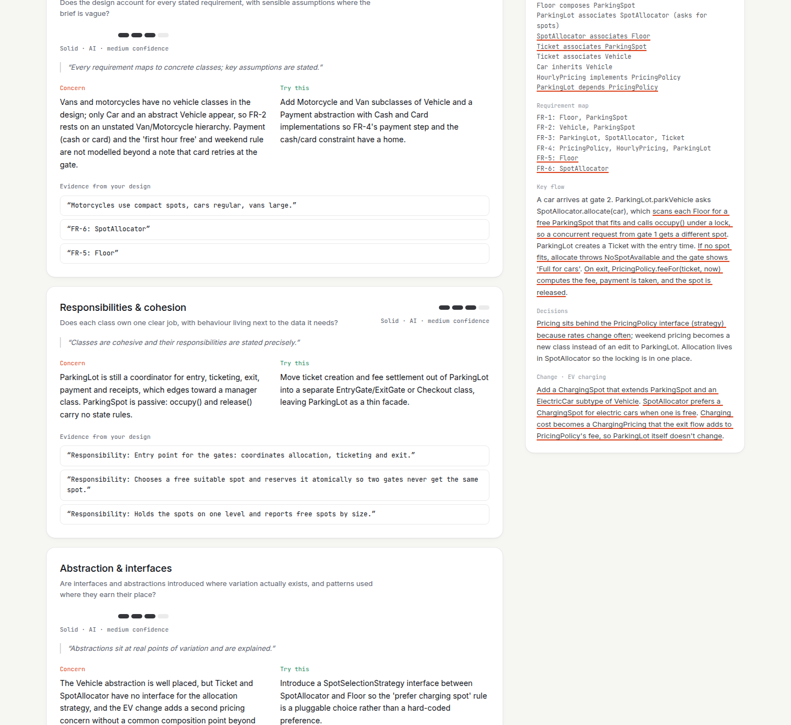
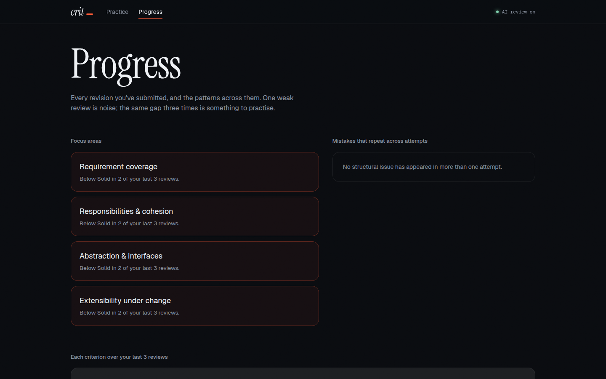

# crit: practise low-level design, get a crit, design it better

A small practice platform for low-level design (LLD). Pick a problem, lay out your classes and the reasoning behind them, and get feedback that is graded against a fixed rubric and **quotes your own design back to you**. Revise, and the next review tells you what you fixed.

- **Live demo:** _add link after deploying_
- **Docs:** [Research note](docs/RESEARCH.md) · [Design note](docs/DESIGN.md) · [AI usage](AI_USAGE.md)



## The practice loop

| | |
|---|---|
| **1. Choose a problem.** Four classics with numbered requirements, constraints, and a requirement change you'll have to absorb. |  |
| **2. Design.** A structured canvas: assumptions, classes with one-sentence responsibilities, typed relationships, a requirement → class map, a key flow, decisions, and your response to the change. The UML class diagram draws itself as you type, and structural checks run live. Drafts autosave. |  |
| **3. Submit and get a crit.** Six rubric criteria on a four-step scale, each with a concern, a concrete suggestion and quotes from your design. Quotes are verified and underlined in your submission. Deterministic facts cap optimistic grades. |  |
| **4. Revise.** Revision 2 shows band changes and which issues were fixed, are still open, or are new. |  |
| **5. See your patterns.** Trends per criterion, focus areas (weak in 2 of your last 3 reviews), and mistakes that repeat across problems. |  |

## Run it

Requires **Node 22.13+**. SQLite comes from Node's built-in `node:sqlite`, so there are no native modules to compile.

```bash
git clone <this repo> crit-lld && cd crit-lld
npm install
cp .env.example .env        # optional: add ANTHROPIC_API_KEY for AI review
npm run build
npm start                   # http://localhost:4000
```

Without an API key everything still works: submissions get complete rule-based feedback, clearly labelled.

**Development** (API on :4000, Vite with hot reload on :5173, which proxies `/api`):

```bash
npm run dev
```

**Tests and checks:**

```bash
npm test          # 61 server tests: domain, checks, evaluation pipeline, worker failure modes, HTTP API
npm run typecheck
```

### Configuration

| Variable | Default | Meaning |
|---|---|---|
| `ANTHROPIC_API_KEY` | – | Enables AI review. Without it the app runs in rules-only mode |
| `LLM_MODEL` | `claude-haiku-5-5` | Model used for the rubric review |
| `LLM_TOTAL_CALLS` | unlimited | Lifetime cap on paid reviews for the deployment (the public demo uses 30) |
| `LLM_DAILY_CALLS` | `200` | Hard cap on paid reviews per 24 h; beyond it, rules-only |
| `LLM_PER_LEARNER_HOURLY` | `10` | Per-learner cap |
| `AI_REVIEW` | – | Set to `off` to force rules-only mode |
| `DATABASE_PATH` | `./data/crit.db` | SQLite file (relative to `server/`) |
| `PORT` | `4000` | HTTP port |

## How it's built

```
server/   Node + TypeScript + Express, SQLite (node:sqlite), Anthropic SDK, zod, Vitest
  src/domain/        Attempt, Submission, Evaluation (state machine), Problem, Rubric, Feedback, DesignModel, SubmissionFormat
  src/formats/       DesignCanvasFormat: parse, readiness rules, → DesignModel, canonical rendering
  src/evaluation/    Evaluator interface; RuleBasedEvaluator + DesignChecks; LLM judge; FeedbackAssembler; revision diff
  src/application/   PracticeService, EvaluationWorker (lease, retries, recovery), ProgressService, ports
  src/infra/         SQLite repositories (versioned writes), InProcessQueue, logger
  src/http/          routes, DTOs, error mapping
  src/container.ts   the only place that wires concrete classes
web/      React 19 + Vite + Tailwind 4 + motion, dagre for diagram layout
docs/     research and design notes, screenshots
```

## Key decisions

- **Rubric, not a reference solution.** LLD has many valid answers. Six criteria with described bands make feedback comparable and actionable.
- **Facts before opinions.** Deterministic checks run first, are passed to the model as verified facts, and cap its grades. The model must quote the design, and every quote is checked in code.
- **Structured text as the submission format**: the smallest format that captures both structure (checkable) and reasoning (judgeable). New formats plug in behind `SubmissionFormat`.
- **Evaluation never blocks and never loses work.** Submit stores and enqueues (202). The evaluation is a state machine with leases, retries and recovery. AI failure degrades to rules-only feedback instead of an error. Idempotency keys and content hashes prevent duplicates.
- **Cheap by design.** Claude Haiku 5.5 at low effort: about $0.0015 per review, cached on identical input, with daily and per-learner caps.

More detail, including the two change tests and what I'd split out first at scale, is in the [design note](docs/DESIGN.md).

## Limitations

- No accounts: history is tied to an anonymous id in browser storage.
- The deterministic checks are heuristic and English-centric; they produce findings and caps, never top grades.
- The AI grader isn't calibrated against a hand-graded set yet.
- Single process (SQLite and an in-process queue). The path out is in the design note.
- The public demo runs on a free instance: it sleeps when idle (the first load can take ~50 s), its history resets when it restarts, and its AI reviews are capped at 30 in total, after which it falls back to rules-only feedback.
- The design is described, not executed: no code submission yet.
