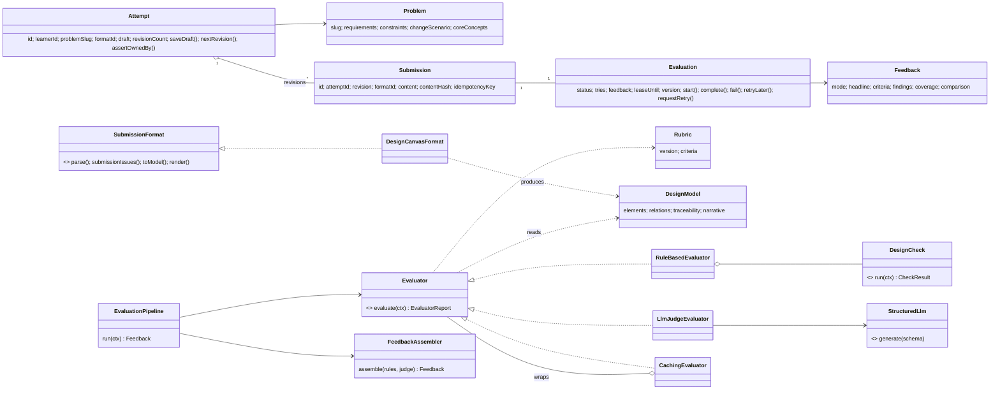
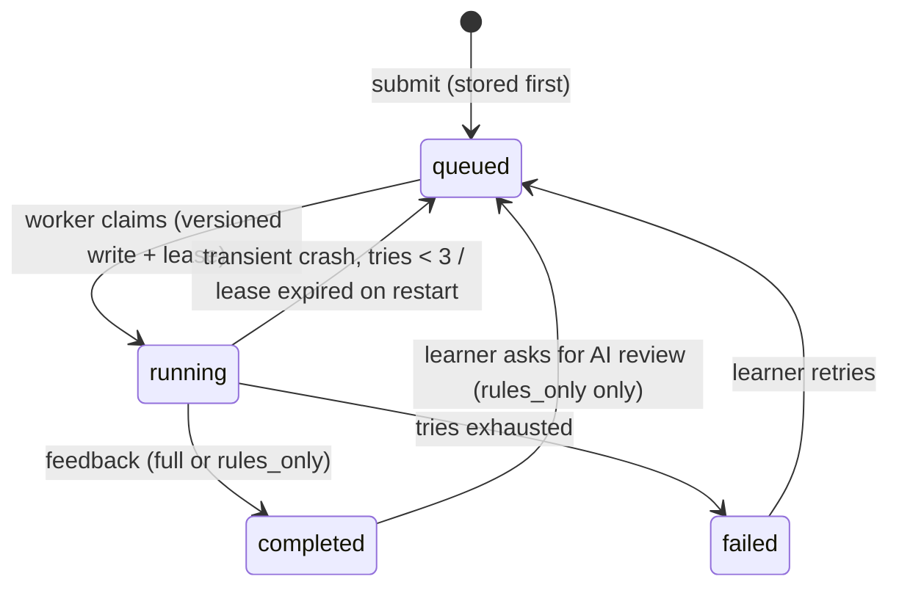

# Design note

## 1. The MVP in one paragraph

Four LLD problems (Parking Lot, Vending Machine, Expense Sharing, Elevator), each with numbered requirements, constraints and a **requirement change** the learner has to absorb. The learner fills a **design canvas**: assumptions, classes with responsibilities, typed relationships, a requirement-to-class map, a key flow, decisions and a response to the change. A live UML diagram and live structural checks update as they type. On submit, the design is stored immediately and evaluated in the background. **Deterministic checks** run first. A **cheap LLM** (Claude Haiku 5.5) then grades six rubric criteria, and must quote the design as evidence for each. The platform verifies every quote, caps grades that contradict hard facts, and shows the result next to the learner's own text with the evidence underlined. Revising produces revision 2, whose feedback lists what was fixed. A progress page shows criteria that keep coming up weak.

## 2. User flow

```
Problems ─▶ Problem brief ─▶ Workspace (autosaved draft, live diagram, live pre-flight)
                                  │ submit (idempotent)
                                  ▼
                     Feedback page: queued → running → completed / failed
                     (rules-only feedback if AI is unavailable; "ask for AI review" later)
                                  │
                ┌─────────────────┴──────────────────┐
                ▼                                    ▼
        Revise (revision n+1,               Progress: trends per criterion,
        diff vs revision n)                 focus areas, recurring mistakes
```

## 3. What a learner must provide, and why

| Canvas section | Evidence of | Deterministic use |
|---|---|---|
| Assumptions | Requirement understanding; handling ambiguity | Present / absent |
| Classes (name, kind, one-sentence responsibility, attributes, methods) | Responsibilities, cohesion, abstraction | God-class signals, vague or data-only classes, unrealised interfaces |
| Relationships (inherits, implements, composes, aggregates, associates, depends) | Coupling, correct relationship kinds | Orphans, ownership cycles, fan-out, `implements` on a class |
| Requirement map (FR → classes) | Coverage, traceability | Unmapped requirements, one class owning most requirements |
| Key flow | Behaviour, collaboration, failure handling | Uses the declared classes? Mentions any failure? |
| Decisions | Trade-off reasoning | Patterns named without a justification |
| Response to change | Extensibility | Answered at all? Grounded in the learner's classes? |

Submission requires the minimum that makes review meaningful: at least 3 named classes with a responsibility sentence, at least one relationship, and a key flow of a few sentences. Everything else is graded rather than required, because missing it is useful feedback in itself.

**Why a structured canvas and not code or a diagram?** Code proves more but needs a sandbox, per-language parsing, and 30–60 minutes from the learner before any feedback. A diagram shows structure but not reasoning. The canvas is the smallest format that captures *both* structure (checkable by rules) and reasoning (judgeable by a reviewer), and it can be rendered as a diagram for free.

## 4. Architecture

A single Node/TypeScript monolith with an SQLite file, plus a React SPA served by the same process. Layers depend inward only:

```
http/ (Express routes, DTO presenters, error → status mapping)
  └─▶ application/ (use cases: PracticeService, EvaluationWorker, ProgressService; ports)
        └─▶ domain/ (Attempt, Submission, Evaluation, Problem, Rubric, Feedback, DesignModel, SubmissionFormat)
        └─▶ evaluation/ (Evaluator interface, RuleBasedEvaluator + DesignChecks, LlmJudgeEvaluator, FeedbackAssembler)
infra/ (SQLite repositories, InProcessQueue, logger) implements application ports
container.ts is the only file that names concrete classes.
```

## 5. Domain model



| Class | Owns | Why it exists |
|---|---|---|
| `Attempt` | The mutable draft and revision numbering; ownership check | "Try again" is a new revision of the same attempt, so revisions can be compared |
| `Submission` | An immutable snapshot plus a content hash | Saved before evaluation, so an evaluator crash never loses work; the hash deduplicates identical resubmits |
| `Evaluation` | The lifecycle state machine, try count, lease and version | Makes slow or failing evaluation explicit and safe to retry; illegal transitions throw |
| `SubmissionFormat` | Parse, readiness rules, translation to `DesignModel`, canonical rendering | **The variation point for new submission formats** (see change test A) |
| `DesignModel` | Format-agnostic elements, relations, traceability and narrative | Evaluators never see the raw format |
| `Evaluator` | One way of judging a design | **The variation point for new evaluators** (see change test B) |
| `DesignCheck` | One deterministic rule | Small, independently testable rules; adding one is one class |
| `FeedbackAssembler` | The merge policy | One place decides how rules and AI combine |
| `CachingEvaluator` | Cache by input hash | Keeps cost logic out of the judge (a decorator, because caching is orthogonal) |
| `UsageBudget` / `UsageLedger` | Daily and per-learner caps on paid calls | A public demo can't run up a bill |
| `ProblemCatalog` | Problem content | Content could move to a DB or CMS without touching use cases |

Abstractions I chose **not** to add: no separate `Rubric` per problem (one rubric keeps results comparable across problems), no `User` aggregate (an anonymous browser id is enough for an MVP), no event bus (the worker is called directly through a small `JobQueue` port).

## 6. Evaluation approach

### What is deterministic, what is AI

| Deterministic (rules) | Judgement (LLM) |
|---|---|
| Submission readiness (blocking) | Quality of each responsibility split |
| Requirement coverage from the learner's own map | Whether abstractions sit at real points of variation |
| Ownership cycles, orphans, fan-out, wrong relationship kinds | Whether relationship kinds fit the domain |
| God-class signals, vague or data-only classes | Whether the change response actually holds |
| Change scenario answered and grounded in classes | Trade-off reasoning, edge cases in the flow |
| Pattern named without justification; singleton use | Strengths and prioritised next steps |
| State transitions, idempotency, dedupe, budget | — |
| Verifying the AI's evidence quotes | — |
| Revision-to-revision diff and recurring weaknesses | — |

### Making AI feedback consistent

- **A fixed rubric**, six criteria × four described bands (Missing / Developing / Solid / Strong). There is no 100-point score; a learner can act on "Developing → Solid".
- **Structured output** (JSON schema via the SDK) per criterion: `evidence → concern → band → suggestion → confidence`. The field order is deliberate: the model quotes and names the concern *before* it commits to a band.
- **Rule findings go into the prompt as verified facts** the model must not contradict.
- **No reference solution in the prompt**, plus an explicit instruction that different decompositions are fine.
- **The submission is untrusted data.** The prompt tells the model to ignore instructions inside it, and caps make "give me 4/4" pointless anyway.
- The judge **never sees its previous verdict** on earlier revisions, so it can't anchor on it. Comparison between revisions is computed deterministically.

### Merge policy (`FeedbackAssembler`)

1. Per criterion, the AI's assessment wins over the rules' estimate; criteria the AI skipped fall back to rules.
2. Every quote is checked against the canonical rendering of the submission. Solid-or-better grades with no verifiable quote are downgraded to low confidence and shown as "not found in your design".
3. Deterministic caps override optimistic bands, with the reason shown (for example, extensibility capped at *Missing* when the change scenario wasn't answered).
4. Rule findings are always shown.

Rules-only bands never exceed *Solid* and are always marked low confidence: rules can prove something is missing, but not that a design is good.

**Cost.** One Haiku call per new design, measured at about 4k input and 2k output tokens, roughly **$0.0015 per review**. Identical inputs are served from a cache. A lifetime cap (30 for the public demo), a daily cap and a per-learner hourly cap all degrade gracefully to rules-only.

## 7. When evaluation is slow or fails



- The submit request only stores and enqueues (HTTP 202). The UI polls the submission.
- **The submission and its queued evaluation are written in one transaction**, and enqueued only after commit.
- **Duplicate requests:** an `Idempotency-Key` (one per draft version, generated by the client) returns the original submission, and an identical-content resubmit returns the latest revision instead of creating a new one. Both are enforced by unique indexes too.
- **Duplicate processing:** claiming an evaluation is an optimistic-concurrency update (`WHERE version = ?`), so only one worker wins.
- **AI failure** (rate limit, timeout, refusal, bad JSON, no key, budget) doesn't fail the evaluation. It completes as `rules_only` with the reason, immediately, and the learner can ask for the AI review again later.
- **Crashes** (a bug, a corrupt row) retry with backoff up to three times, then `failed` with a retry button. The design is never lost.
- **Restarts:** on boot, `recover()` re-queues queued work and running work whose lease has expired.

## 8. The two change tests

**A: tomorrow learners submit a class diagram (e.g. PlantUML or Mermaid).** Add a `PlantUmlFormat implements SubmissionFormat` that parses the diagram into the same `DesignModel` and register it. `Attempt`, `Submission`, `Evaluation`, the worker, all checks and the judge are unchanged, because they only see `content: unknown` plus `DesignModel`. Checks that rely on narrative (flow, change response) simply find less, which is the right behaviour. The UI needs a new editor.

**B: add a human reviewer or another automated evaluator.** A synchronous evaluator (say a code-compilation evaluator) is another `Evaluator` passed to `EvaluationPipeline`, and the assembler already merges by criterion. Human review is asynchronous, so I would model it as a *second* `Evaluation` row for the same submission with `kind = "human"`, created by a reviewer queue and completed by the reviewer. The practice flow, attempts and submissions don't change, and the feedback page shows one panel per completed evaluation. Today there is one evaluation per submission. Making the 1:1 a 1:N keyed by kind is the one schema change this would need.

## 9. Scaling, kept practical

- The first thing to separate is the **evaluation worker**. It already only talks to the database and a `JobQueue` port, so it can run as a second process that polls `evaluations WHERE status = 'queued'`. With the versioned claim and lease, several workers can run safely.
- Then move SQLite to Postgres (the repositories are the only SQL), and swap `InProcessQueue` for SQS, Redis or pg-boss behind the same port.
- LLM cost scales with *new* designs only (thanks to caching), and is bounded by the budget caps.

## 10. Trade-offs and limitations

- **Anonymous identity.** History lives under a random id in the browser's localStorage; clearing storage loses it. Accounts are the obvious next step.
- **Heuristic rules are English-centric and shallow.** "Mentions a failure" is a vocabulary check. That's why these checks produce minor or note findings and caps, never top grades.
- **The LLM can still be wrong** within the rubric. Mitigations: evidence that must exist, caps from facts, confidence shown, and an honest "AI + rules" or "rules only" label. There is no calibration set yet; the next step would be 20–30 hand-graded designs used as an eval.
- **The canvas is text, not code.** Behaviour is described, not executed.
- **Polling, not push.** It's fine at this scale; server-sent events would be the upgrade.
- **SQLite and an in-process queue** are a single node. Fine for a prototype, and section 9 covers the path out.

## 11. Tests

61 tests (Vitest + Supertest) cover the state machine (including illegal transitions), canvas parsing and readiness, every deterministic check, evidence verification, the merge and cap policy, revision diffs, the worker (AI rate-limited → rules-only → retry → full; no key; empty AI output; cache hit; budget; crash → 3 tries → failed; lease recovery; concurrent claim), and the HTTP API (full loop, idempotency, dedupe, 422 readiness errors, cross-learner isolation, 400s and 404s, 409 on illegal retry, insights). An LLM fake makes the AI paths deterministic and free.
